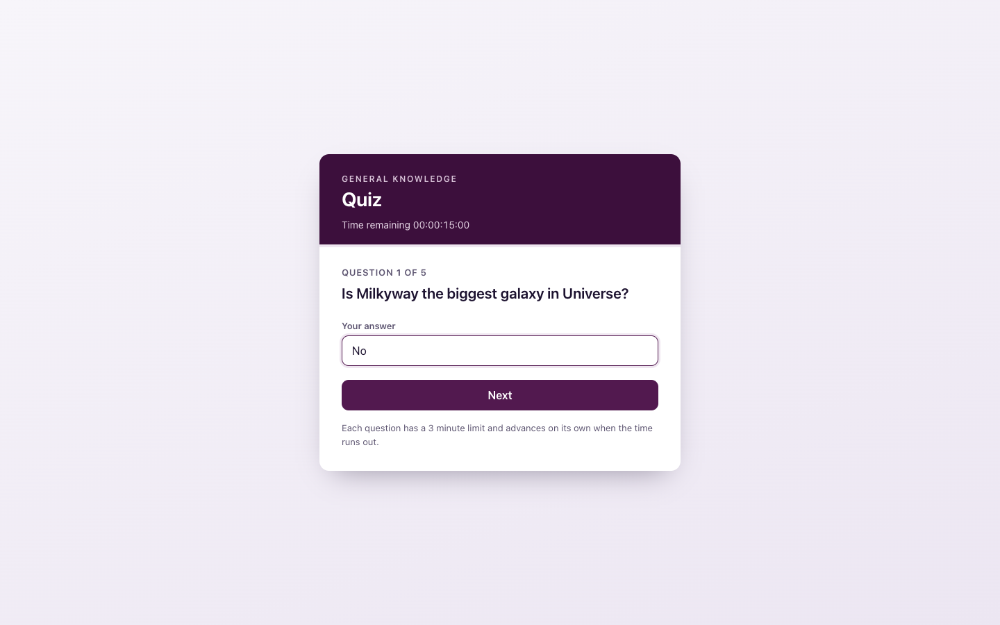
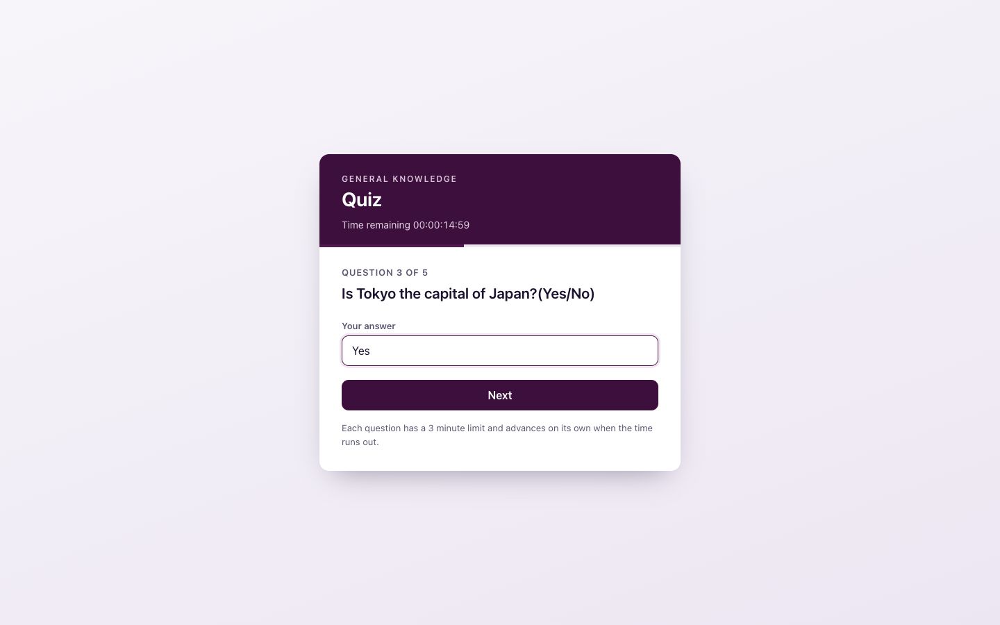
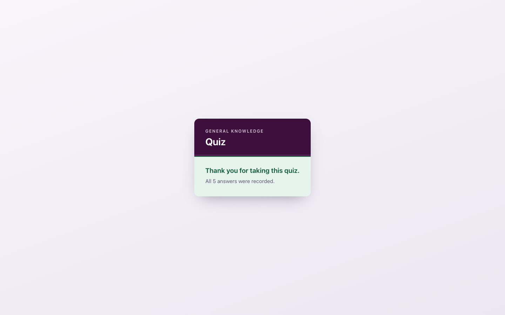
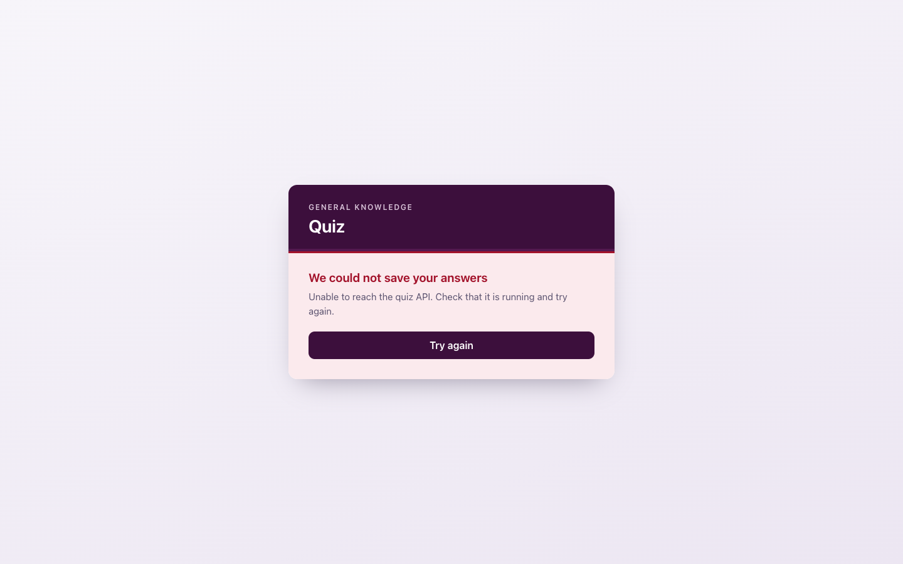
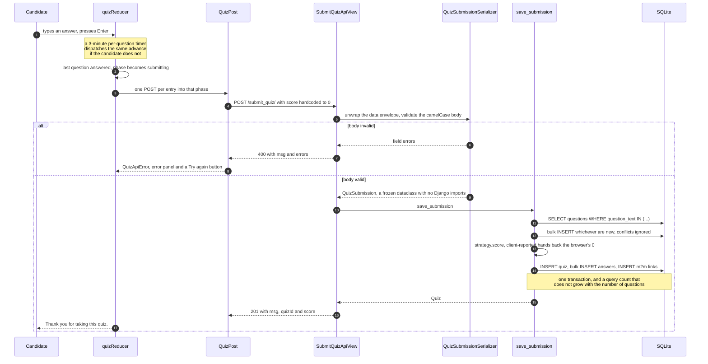
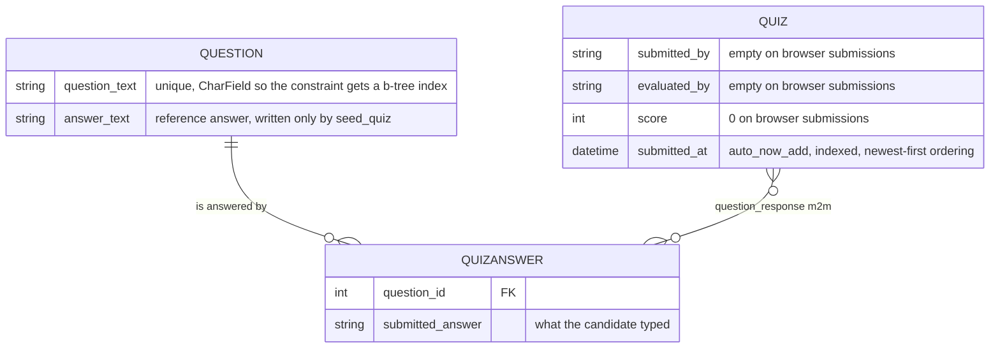

# Timed quiz — a quiz that records answers but never marks them

A Create React App single-page app asks five hard-coded general-knowledge
questions on a timer and POSTs the whole attempt once. A Django REST Framework
service stores that attempt against a de-duplicated question catalogue. There is
no read API at all — the only way to see what was submitted is the Django admin.

Read the next section first: the capture half works, the **marking half was
never built**, and nothing in the UI gives that away.

> **Provenance.** No brief, ticket or client document is committed. The
> repository is named after a company and the API's own README calls the work
> "the task", which reads as a take-home exercise rather than a product — but
> that is inference. Everything here is derived from the code in this checkout;
> what could not be established from the code is under
> [Known gaps](#known-gaps). The commit history is not usable as evidence — see
> [About the history](#about-the-history).

## Every attempt submitted from the browser scores zero

Three facts in the current code, each checkable in a minute:

1. `quiz-app-web/src/components/quiz.js` builds the request body with
   `score: 0` — a literal, not a count. Nothing on the client compares an answer
   to anything.
2. The default strategy is `client-reported` (`QUIZ_SCORING_STRATEGY` in
   `quiz_app_api/quiz_app_api/settings.py`), and `ClientReportedScoring.score`
   returns `submission.reported_score` unchanged. So `Quiz.score` stores the
   browser's `0`, every time.
3. `Question.answer_text` — the column whose whole purpose is to hold the
   reference answer — is written only by `manage.py seed_quiz` and read only by
   the opt-in `exact-match` strategy. On the path a candidate takes, nothing
   writes it and nothing reads it.

Posting exactly what the browser posts makes it plain:

```console
curl -s -X POST http://localhost:8221/submit_quiz/ -H 'Content-Type: application/json' \
    -d '{"data":{"submittedBy":"","evaluatedBy":"","score":0,"question":[
         {"questionText":"Is Tokyo the capital of Japan?(Yes/No)","answerText":"Yes"}]}}'
{"msg":"Quiz response saved successfully","quizId":4,"score":0}
```

The answer is correct and the stored score is `0`. The UI never asks for a name
either, so `submitted_by` and `evaluated_by` are empty strings on every real
submission.

The admin *looks* like grading works, because `seed_quiz` calls `exact-match`
directly for its three sample rows (Ada Lovelace 5, Grace Hopper 3, Alan Turing
3) whatever strategy is configured. Nothing a candidate submits takes that path.
Where a real grader would attach is [below](#where-grading-plugs-in).

## The app

Captured with Playwright at 1440×900 by walking the real quiz — the API on 8221
with its seeded catalogue, the client on 8220. No mocked screens.

| Answering a question | Part-way through |
| --- | --- |
|  |  |

| Submitted | The API is unreachable |
| --- | --- |
|  |  |

## One attempt, end to end



Two details in there are load-bearing. On the client, the per-question timer
effect depends on `[phase, index]` and deliberately *not* on the draft answer —
`quiz.test.js` carries a test named *"typing does not restart the question
clock"*, because that dependency would hand a typist an unlimited extension. On
the server the write is set-based rather than a per-question loop, and
`test_services.py::test_query_count_does_not_grow_with_the_number_of_questions`
asserts the same query count for a 2-question and a 40-question submission — the
property, not a magic number.

## What gets stored



`question_text` is a `CharField` and not a `TextField` because it carries the
uniqueness constraint, and `max_length` on a `TextField` is a form hint Django
never asks the database to enforce. `submitted_at` is indexed so the newest-first
`Meta.ordering` every read path wants is not a filesort. The admin changelists
use `list_select_related` and `raw_id_fields`; without them the answer list
issues a query per row and the quiz change form renders a `<select>` holding
every answer ever submitted. SQLite is deliberate — one append-mostly table, no
concurrent writers — with `DJANGO_SQLITE_PATH` as the escape hatch.

## Run it

```bash
docker compose up --build       # web on 8220, api on 8221
```

- Quiz UI — <http://localhost:8220>
- Health — <http://localhost:8221/healthz/> → `{"status":"ok","database":"ok"}`
- Admin — <http://localhost:8221/admin/>, after
  `docker compose exec api python manage.py createsuperuser`

`entrypoint.sh` runs `migrate` → `seed_quiz` → `collectstatic` before gunicorn,
so the catalogue and the three sample submissions are there the first time you
open the admin. Data lives in the `quiz-data` volume; `docker compose down -v`
discards it.

**The container path is unverified here.** This repo's uplift report records
`Build verified: NOT RUN — deferred, RAM constraint` and `Boot verified: NOT RUN
— deferred, RAM constraint`; only `docker compose config -q` has been checked.
Everything below has actually been run.

```bash
cd quiz_app_api                 # Python 3.10+, 3.11 in the image
python -m venv .venv && source .venv/bin/activate
pip install -r requirements-dev.txt
python manage.py migrate && python manage.py seed_quiz
DJANGO_DEBUG=true python manage.py runserver 8221

python manage.py test                                # 81 tests
ruff check . && black --check .
python manage.py makemigrations --check --dry-run
```

```bash
cd quiz-app-web                 # Node 20 in the image
npm install && cp .env.example .env
PORT=8220 npm start

npm run test:ci                 # 34 tests
npm run lint                    # eslint, zero warnings tolerated
```

The browser talks to the API directly — nginx serves the bundle and does not
proxy — so CORS, not a gateway, is what makes the two origins work together.

## Settings

Everything that differs between a laptop and a deployment comes from the
environment. The ones worth knowing:

| Variable | Default | Purpose |
| --- | --- | --- |
| `DJANGO_SECRET_KEY` | — | Signing key, read from the environment. Set it for anything beyond a local run. |
| `DJANGO_DEBUG` | `false` | Rejects anything that is not an obvious boolean rather than silently defaulting. |
| `DJANGO_ALLOWED_HOSTS` | `localhost,127.0.0.1,[::1]` | Comma-separated. |
| `DJANGO_CORS_ALLOWED_ORIGINS` | `http://localhost:8220,http://127.0.0.1:8220` | Origins allowed to call the API from a browser. |
| `DJANGO_SQLITE_PATH` | `<project>/db.sqlite3` | The container points this at the mounted volume. |
| `DJANGO_TRUST_PROXY_SSL_HEADER` | `false` | Treat `X-Forwarded-Proto: https` as proof of TLS. Only safe behind a proxy that overwrites the header. |
| `QUIZ_SCORING_STRATEGY` | `client-reported` | `client-reported` or `exact-match`. An unknown name fails at boot. |
| `QUIZ_MAX_QUESTIONS_PER_SUBMISSION` | `100` | Cap on one request, so a large body cannot become a large write. |
| `QUIZ_ANON_THROTTLE_RATE` | `60/min` | DRF anonymous throttle. `/healthz/` is exempt — a throttled health probe reports the service down exactly when it is busiest. |

Also read: `DJANGO_STATIC_ROOT`, `DJANGO_CORS_ALLOW_ALL`,
`DJANGO_SECURE_COOKIES`, `DJANGO_LOG_LEVEL`. All of them go through
`quiz_app_api/quiz_app_api/env.py`, whose typed helpers raise on a malformed value instead of
quietly falling back to the default; `test_settings_env.py` covers that. The
client has one variable, `REACT_APP_API_BASEURL`, and it is **required** —
unset, the app throws rather than posting to a wrong host. CRA inlines it at
build time, so in Docker it is a build argument, not a runtime variable.

## Where grading plugs in

`scoring.py` is a name → instance registry: a class with a `name` and a `score`
method, decorated with `@register_strategy`. `QUIZ_SCORING_STRATEGY` picks one and
`QuizConfig.ready()` resolves it at start-up, so a typo is a failed boot rather
than a 500 on every submission. Two strategies ship: `client-reported`, the
default, which is bit-for-bit the existing wire behaviour, and `exact-match`,
which compares case- and whitespace-insensitively against the seeded catalogue
and awards nothing for a question with no reference answer on record — so an
un-seeded database grades everything zero rather than silently handing out marks.

`dto.py` and `scoring.py` import no Django at all, so grading and validation are
`SimpleTestCase` tests that never open a database, and a partial-credit rule or a
model-graded free-text answer is a class and a decorator with no change to view,
serializer or service. One seam and not several, on purpose: a storage provider
interface or a question-type plugin system would be speculation, whereas the data
model says outright that grading is what is missing.

## Two things a container would otherwise get wrong

**The admin has no CSS without WhiteNoise** — and the admin is the project's only
read surface. Django's staticfiles app serves nothing outside `runserver` with
`DEBUG` on, so under gunicorn, with nothing serving `STATIC_ROOT`, every admin
asset is a 404. WhiteNoise sits directly behind the security middleware and
`entrypoint.sh` runs `collectstatic` on boot;
`test_whitenoise_runs_directly_after_the_security_middleware` pins the ordering.
`CompressedStaticFilesStorage` rather than the manifest variant is deliberate: a
skipped `collectstatic` then costs unhashed filenames instead of a 500 on every
admin page.

**`SECURE_PROXY_SSL_HEADER` is opt-in.** Trust it unconditionally and any client
can send `X-Forwarded-Proto: https` and have Django treat a plain-HTTP request as
secure, so it is gated behind `DJANGO_TRUST_PROXY_SSL_HEADER` with
`test_not_trusted_by_default` asserting the default is off. Turn it on only
behind a proxy that overwrites the header.

Related: `SECRET_KEY`, `DEBUG`, `ALLOWED_HOSTS` and the CORS origins are all
environment reads defaulting to the safe value. An unset `DJANGO_SECRET_KEY`
generates a random key for that process and warns, rather than falling back to a
constant baked into the file.

## Known gaps

- **Nothing is graded and nobody is named.** The headline finding above. The API
  accepts `submittedBy` / `evaluatedBy` and the seed data fills them, but the UI
  has no name field and there is no sign-in.
- **The question list is duplicated.** With no endpoint that serves questions,
  `quiz-app-web/src/constants/constants.js` and
  `quiz_app_api/quiz/fixtures_data.py` each carry a copy and must be kept in step
  by hand. A `GET /questions/` endpoint would fix it — and would be a new
  feature, which is why it is not here.
- **The reference answers are a judgement call.** The five seeded answers were
  chosen as the factually correct response to each question. They were not
  supplied with the project, and `exact-match` is only as right as they are.
- **Submissions are write-only over HTTP.** No list or detail endpoint, no
  pagination, no authentication: anyone who can reach the API can post, and the
  anonymous throttle is the only limit.
- **The timers are client-side.** A reload starts a fresh clock, and the server
  neither knows nor enforces a time limit.
- **SQLite on a volume, no backup story, and no CI.** Every command above is real
  and passes, but nothing runs them automatically.
- **CRA 5 is unmaintained upstream.** Left alone deliberately: moving to Vite is
  a rewrite of the build, not an uplift.

## About the history

The log is not a usable record of how this was built. The commit dated
2023-03-06 already pins `Django==4.2.20` and `whitenoise==6.8.2`, neither of
which existed then — the dates and the messages are reconstructed, so nothing
above is argued from them. Every claim came from the working tree instead: the
test counts by running both suites, the API bodies by calling the endpoints, the
seeded scores by running `seed_quiz` against an empty database.

Per-service notes: [`quiz_app_api/README.md`](quiz_app_api/README.md) and
[`quiz-app-web/README.md`](quiz-app-web/README.md).
