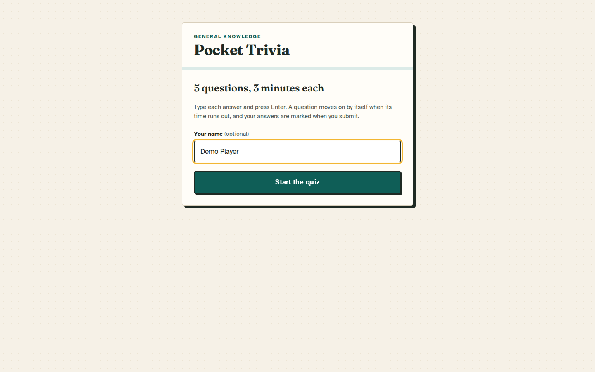
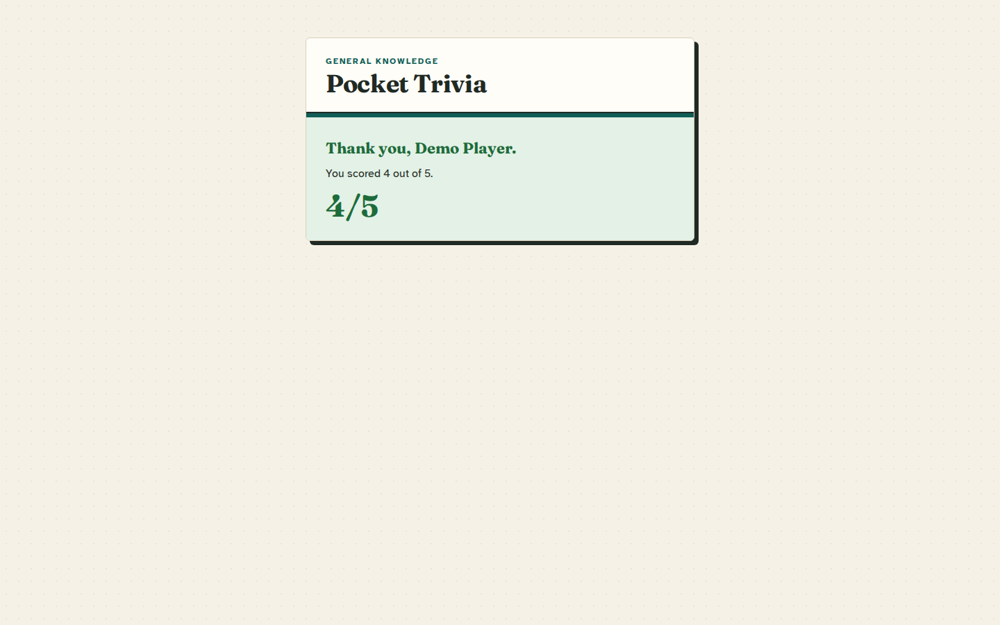
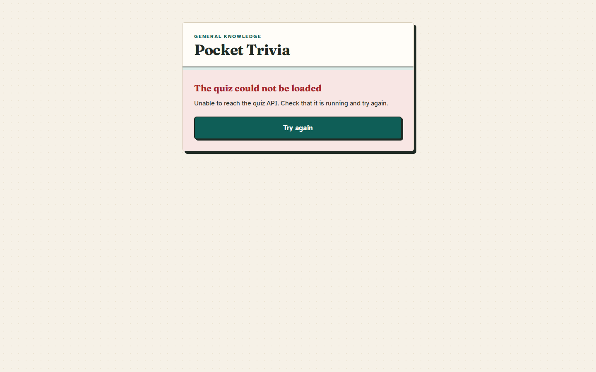
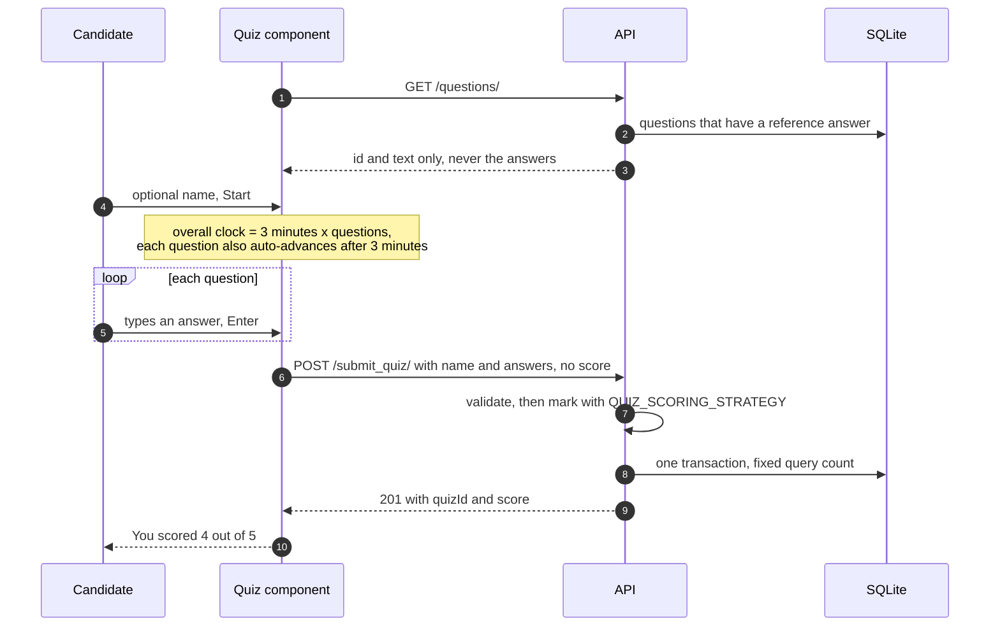
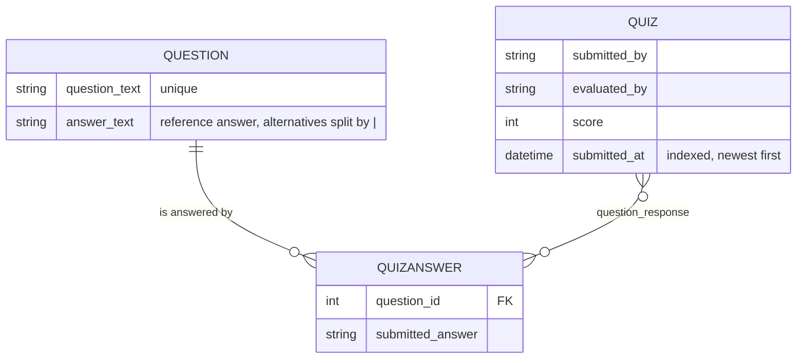

# Pocket Trivia

A short, timed general-knowledge quiz. A React client asks the questions one at
a time against a stopwatch; a Django REST Framework API serves those questions,
marks the answers against reference answers it keeps to itself, and stores each
attempt in SQLite. The Django admin is where submissions are read.

The project is small on purpose. What it does carefully: the answers never leave
the server, marking happens server-side so a client cannot award itself points,
a submission is one transaction with a fixed number of queries however many
questions it carries, and the client covers loading, empty, failed-submit and
timed-out paths rather than only the happy one.

| Start | Answering |
| --- | --- |
|  |  |

| Marked | API unreachable |
| --- | --- |
|  |  |

<p align="center">
  
</p>

Screenshots are taken with Playwright against the Compose stack and its seeded
demo questions.

## Run it

```bash
docker compose up --build       # web on 8220, API on 8221
```

- Quiz: <http://localhost:8220>
- Health: <http://localhost:8221/healthz/>
- Admin: <http://localhost:8221/admin/>, after
  `docker compose exec api python manage.py createsuperuser`

On boot the API container runs `migrate`, `seed_quiz` (five sample questions and
three sample attempts) and `collectstatic`, then starts gunicorn. Data lives in
the `quiz-data` volume; `docker compose down -v` discards it. Optional overrides
(secret key, marking strategy, log level) go in a `.env` file next to
`docker-compose.yml`; see [`.env.example`](.env.example).

### Without Docker

The API needs Python 3.13 (`quiz_app_api/.python-version`), the client Node 22
(`quiz-app-web/.nvmrc`).

```bash
cd quiz_app_api
python -m venv .venv && source .venv/bin/activate
pip install -r requirements-dev.txt
python manage.py migrate && python manage.py seed_quiz
DJANGO_DEBUG=true python manage.py runserver 8221
```

```bash
cd quiz-app-web
npm ci
cp .env.example .env            # VITE_API_BASEURL=http://localhost:8221/
npm run dev                     # http://localhost:8220
```

### Tests and lint

```bash
cd quiz_app_api
python manage.py test                            # 99 tests
ruff check . && black --check .
python manage.py makemigrations --check --dry-run

cd ../quiz-app-web
npm run test:ci                                  # 60 tests (Vitest)
npm run lint                                     # ESLint, zero warnings allowed
npm run build
```

## One attempt, end to end



The client keeps every state transition in one reducer
(`quiz-app-web/src/components/quizReducer.js`): loading, unavailable, ready,
answering, submitting, submitted, failed. The per-question timer effect depends
on which question is showing and not on the text being typed, so a keystroke
never restarts the clock; a test pins that.

## API

| Method | Path | Purpose |
| --- | --- | --- |
| `GET` | `/questions/` | The quiz to ask: catalogue questions that have a reference answer, in id order, without the answers. |
| `POST` | `/submit_quiz/` | Record and mark one attempt. |
| `GET` | `/healthz/` | Liveness plus a database round-trip. Not throttled. |
| — | `/admin/` | Questions (editable) and submissions. Needs `createsuperuser`. |

Captured from the Compose stack after a fresh `docker compose up --build`:

```bash
curl -s http://localhost:8221/questions/
```

```json
{"questions":[{"id":1,"questionText":"Which planet is known as the Red Planet?"},{"id":2,"questionText":"What is the chemical symbol for gold?"},{"id":3,"questionText":"How many sides does a hexagon have?"},{"id":4,"questionText":"What is the largest ocean on Earth?"},{"id":5,"questionText":"In which city is the Colosseum?"}]}
```

```bash
curl -s -X POST http://localhost:8221/submit_quiz/ -H 'Content-Type: application/json' \
  -d '{"data":{"submittedBy":"Sam Rivera","question":[
        {"questionText":"Which planet is known as the Red Planet?","answerText":"mars"},
        {"questionText":"What is the chemical symbol for gold?","answerText":"Ag"},
        {"questionText":"How many sides does a hexagon have?","answerText":"six"}]}}'
```

```json
{"msg":"Quiz response saved successfully","quizId":4,"score":2}
```

```bash
curl -s -X POST http://localhost:8221/submit_quiz/ -H 'Content-Type: application/json' \
  -d '{"question":[]}'
```

```json
{"msg":"Question list must be a non-empty array","errors":{"question":["Question list must be a non-empty array"]}}
```

The body may also be sent bare, without the `data` wrapper. Only `question` is
required; `submittedBy`, `evaluatedBy` and `score` are optional, and `score` is
only read by the `client-reported` strategy. Field errors come back as a 400 with
a one-line `msg` for display and the full detail under `errors`.

## Marking

`quiz_app_api/quiz/scoring.py` is a small registry: a class with a `name` and a
`score` method, registered with `@register_strategy`, chosen by
`QUIZ_SCORING_STRATEGY`. The app checks the name at start-up, so a typo fails the
boot instead of every submission.

- `exact-match` (default) gives a point for each answer that equals the stored
  reference answer, ignoring case and surrounding spaces. A reference answer can
  list accepted spellings separated by `|`, as in `6|six`. A question with no
  reference answer scores nothing, so an unseeded database never hands out marks.
  The evaluator is recorded as `exact-match` unless the caller names one.
- `client-reported` stores whatever `score` the caller sent, for callers that
  mark elsewhere.

`dto.py` and `scoring.py` import nothing from Django, so marking is tested with
plain `SimpleTestCase`s.

## What gets stored



`question_text` is a `CharField` rather than a `TextField` because it carries
the unique constraint and needs a real index. Saving a submission resolves all
its questions in one query, bulk-inserts any new ones with conflicts ignored (two
concurrent submissions can both see a question as new), then bulk-inserts the
answers and links. `test_query_count_does_not_grow_with_the_number_of_questions`
asserts the same query count for 2 and 40 questions. The admin uses
`list_select_related` and `raw_id_fields` so its pages do not issue a query per
row or load every answer into a select box.

SQLite fits one append-mostly table with no concurrent writers;
`DJANGO_SQLITE_PATH` points it at the Compose volume.

## Settings

All configuration is environment variables read through
`quiz_app_api/quiz_app_api/env.py`, whose helpers reject malformed values instead
of falling back silently. [`quiz_app_api/.env.example`](quiz_app_api/.env.example)
lists them for a local run.

| Variable | Default | Purpose |
| --- | --- | --- |
| `DJANGO_SECRET_KEY` | random per process, with a warning | Signing key. Set it for anything beyond a local run. |
| `DJANGO_DEBUG` | `false` | Anything other than an obvious boolean is an error. |
| `DJANGO_ALLOWED_HOSTS` | `localhost,127.0.0.1,[::1]` | Comma-separated. |
| `DJANGO_CORS_ALLOWED_ORIGINS` | `http://localhost:8220,http://127.0.0.1:8220` | Origins allowed to call the API from a browser. |
| `DJANGO_SQLITE_PATH` | `quiz_app_api/db.sqlite3` | Compose points it at the `quiz-data` volume. |
| `DJANGO_TRUST_PROXY_SSL_HEADER` | `false` | Trust `X-Forwarded-Proto: https`. Only safe behind a proxy that overwrites it. |
| `QUIZ_SCORING_STRATEGY` | `exact-match` | `exact-match` or `client-reported`. |
| `QUIZ_MAX_QUESTIONS_PER_SUBMISSION` | `100` | Cap on one submission, and on the list `/questions/` serves. |
| `QUIZ_ANON_THROTTLE_RATE` | `60/min` | DRF anonymous throttle. `/healthz/` is exempt. |

Also read: `DJANGO_STATIC_ROOT`, `DJANGO_CORS_ALLOW_ALL`, `DJANGO_SECURE_COOKIES`,
`DJANGO_LOG_LEVEL`. The client has one variable, `VITE_API_BASEURL`, which Vite
inlines at build time; in Docker it is a build argument. Unset, the client
reports a configuration error instead of calling a wrong host.

## Deployment details worth knowing

- **WhiteNoise serves the admin's static files.** Under gunicorn nothing else
  would, and the admin is the only place to read submissions. A test pins it
  directly after the security middleware. The non-manifest storage backend means
  a skipped `collectstatic` costs unhashed filenames, not a 500.
- **`SECURE_PROXY_SSL_HEADER` is opt-in.** Always trusting it would let any
  client mark a plain-HTTP request as secure.
- **Both images run as non-root.** The web image is nginx serving the built
  bundle with long-lived caching for hashed assets and `no-store` on
  `index.html`; it does not proxy, so CORS is what joins the two origins.

## Known gaps

- **No accounts.** The name is free text, anyone who can reach the API can
  submit, and the anonymous throttle is the only limit.
- **Submissions are read in the admin only.** There is no list or detail
  endpoint for attempts.
- **The timers run in the browser.** A reload starts a fresh attempt; the server
  does not enforce a time limit.
- **Marking is literal.** `exact-match` knows listed alternatives but not typos
  or synonyms.
- **Submissions can add catalogue rows.** A POST with an unknown question text
  stores that question (without a reference answer). It is never served or
  marked, but it does sit in the table; rejecting unknown questions would change
  the existing API contract.
- **SQLite on a volume** with no backup routine.

## Layout

```
quiz_app_api/                Django project (Python 3.13, Django 5.2)
  quiz/                      models, serializers, scoring, services, views, tests
  quiz/management/commands/  seed_quiz
quiz-app-web/                React 19 client (Vite 8, Vitest)
  src/components/            Quiz, quizReducer, clock
  src/api.js                 fetchQuestions and submitQuiz
docker-compose.yml           both services, ports 8220 and 8221
```

Per-service notes: [`quiz_app_api/README.md`](quiz_app_api/README.md) and
[`quiz-app-web/README.md`](quiz-app-web/README.md).

## License

[MIT](LICENSE).
